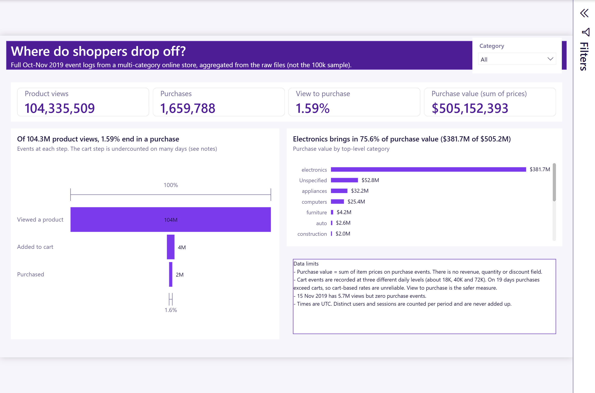
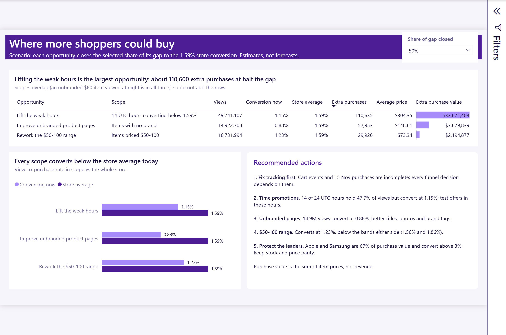
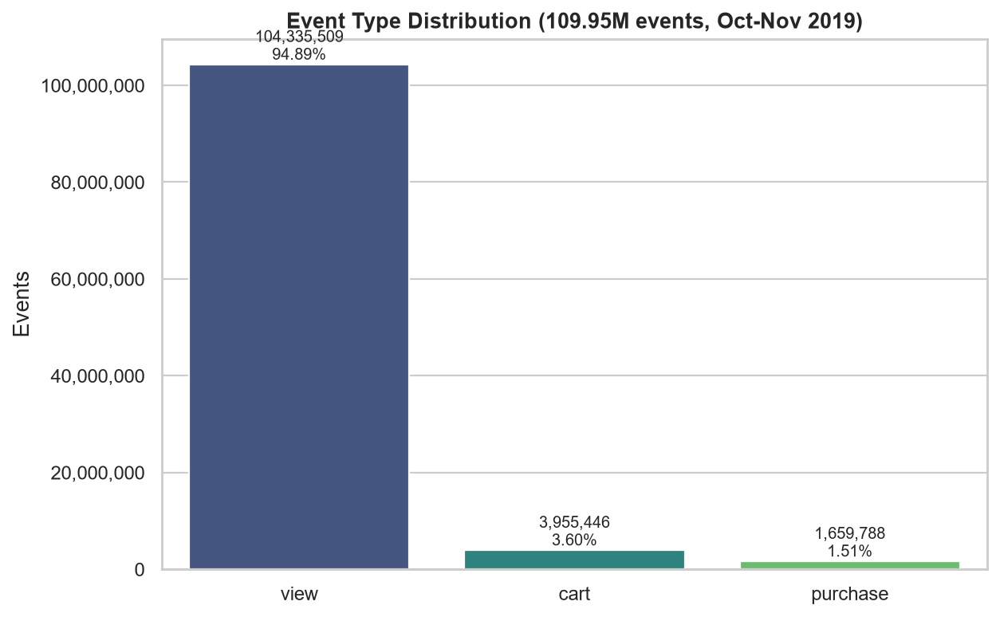
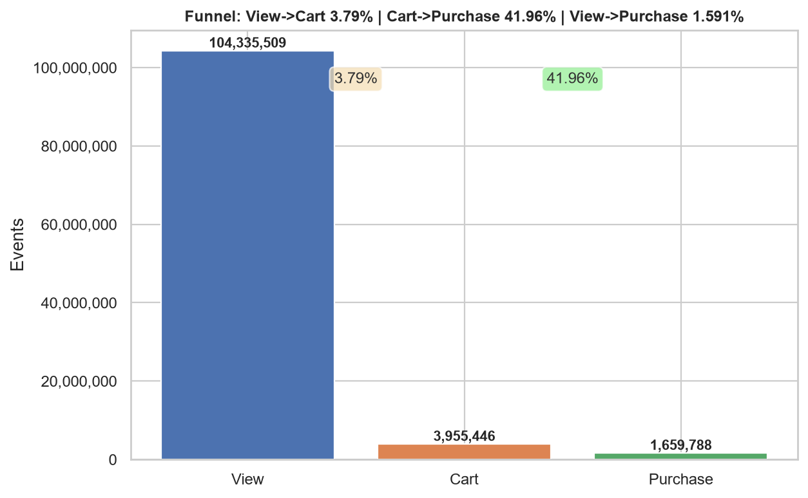
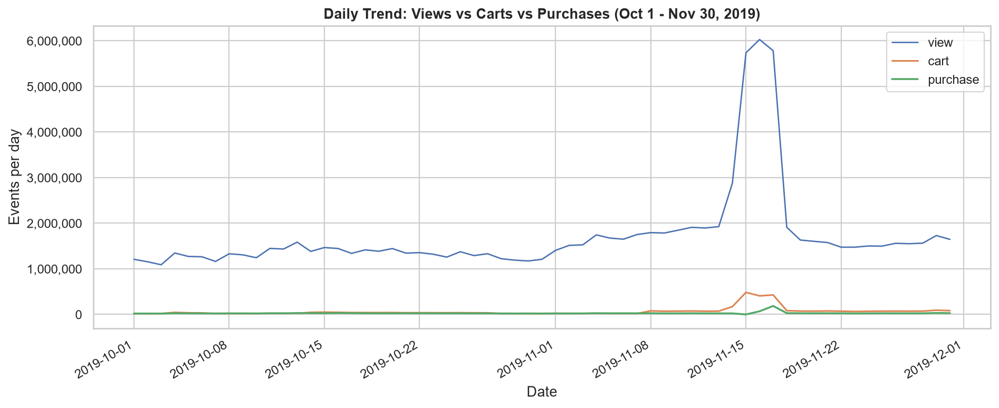

# Ecommerce Multi-Category Store Behavioral & Funnel Analysis

I analyzed 109.95 million user interaction events (product views, cart additions, and purchases) recorded across an online retail store between October 1 and November 30, 2019. The objective was to unpack browsing patterns, identify where prospective buyers drop off during checkout, and profile product price elasticity without overwhelming memory or degrading data integrity.

## The dashboard

Six pages answering "where do shoppers drop off?", all built from the full 109.95M-event logs:

* **Funnel** - 104.3M views, 1.66M purchases, 1.59% view to purchase and $505.15M purchase value (the sum of item prices; there is no revenue field), with the data limits stated on the page.
* **Oct vs Nov** - cart to purchase falls from 80.2% to 30.3%, but daily cart events sit at three distinct levels and 15 Nov has zero purchases, so this looks like a tracking change rather than proven shopper behaviour.
* **Timing and price** - conversion by weekday and UTC hour, and value vs conversion by price band.
* **Brands and categories** - Apple is 47.3% of purchase value and smartphones 66%; unbranded items convert at 0.88%.
* **Daily detail** - purchase value, distinct users and daily conversion, plus the unusual days to check.
* **Action plan** - three conversion opportunities benchmarked to the 1.59% store rate, sized with a slider, and the first action: fix event tracking.




## Raw Data & Identified Constraints
* **Massive Scale**: 109,950,743 raw rows spanning ~14.7 GB uncompressed across two monthly CSV files. Loading this directly into standard data tools would cause immediate out-of-memory crashes.
* **Missing Identifiers**: `brand` is missing in 13.95% of events (15,341,158 records) and `category_code` is missing in 32.21% (35,413,780 records). I chose not to impute or drop these records, because doing so would severely distort traffic volume and session paths. Instead, I explicitly flagged them and assigned an `unknown` categorical dimension.
* **Identifier Precision Hazards**: `category_id` values exceed 2^53 integer precision (64-bit integer space). Standard JavaScript or downstream integer casts silently round these identifiers, corrupting joins. I enforced strict string/text typing across the entire pipeline.
* **Pricing Oddities**: Exactly 256,761 records recorded `price <= 0` (or $0.00). Rather than silently erasing them, I kept them in the audit trail and created a dedicated `PurchasePrice` measure that isolates revenue to genuine purchase transactions.

## Data Cleaning & Transformation Decisions
1. **Chunked ETL Processing**: I implemented a streaming processor reading 1,000,000 rows per chunk, parsing timestamps with UTC offsets into ISO datetimes and splitting out `event_date` and `hour`.
2. **Category Hierarchy Extraction**: I split dot-delimited `category_code` strings into a 3-tier hierarchy (`category_main`, `category_sub`, `category_detail`), allowing drilldowns from broad departments (electronics, appliances) down to specific item categories.
3. **Revenue Isolation**: I established that `price` on a view event is not revenue. I created `PurchasePrice` (strictly `price` when `event_type == 'purchase'`, 0 otherwise) and binned items into 8 ordered price bands ($0-10, $10-25, $25-50, $50-100, $100-250, $250-500, $500+, and unknown).

```sql
SELECT
    event_type,
    COUNT(*) AS total_events,
    COUNT(DISTINCT user_session) AS distinct_sessions,
    ROUND(COUNT(*) * 100.0 / SUM(COUNT(*)) OVER(), 2) AS event_share_pct
FROM dbo.Ecommerce_Events
GROUP BY event_type
ORDER BY total_events DESC;
```

## Data Validation Results
Across 54 cross-check assertions spanning Python, Parquet, and SQL Server:
* **Row Integrity**: Exactly 109,950,743 events reconciled between raw and cleaned storage with zero dropped rows (October: 42,448,764; November: 67,501,979).
* **Funnel Breakdown**: Views represent 104,335,509 events (94.89%); Cart additions represent 3,955,446 events (3.60%); Completed Purchases represent 1,659,788 events (1.51%).
* **Conversion Ratios**: Overall View-to-Cart rate is 3.79%; Cart-to-Purchase rate is 41.96%; end-to-end View-to-Purchase conversion sits at 1.59%.
* **Gross Merchandise Volume**: Total purchase value reached $505,152,392.77 across the two-month window, with an average ticket price of $304.35 per transaction.

## Key Findings & Visuals

### 1. Funnel Attrition & Event Volume
Browsing dwarfs transaction activity: less than 4 in 100 product views lead to an item entering a cart, though once in the cart, conversion jumps significantly to nearly 42%.





### 2. Daily Demand Trends
Traffic surged dramatically in November (+59% over October volume), peaking sharply around mid-November promotional sales spikes.



## Folder Contents
* [`raw_unedited/README.txt`](raw_unedited/README.txt) - Source specification. The raw files (about 14.7 GB) are not in Git; download them from Kaggle and point `build_summaries.py` at them.
* [`data/cleaned/`](data/cleaned/) - Curated sample (`Ecommerce_cleaned_sample_100k.csv`) and comprehensive quality audit logs.
* [`notebooks/Ecommerce_analysis.ipynb`](notebooks/Ecommerce_analysis.ipynb) - Full analysis notebook including streaming ETL and data profiling.
* [`sql/Ecommerce.sql`](sql/Ecommerce.sql) - Production DDL, staging tables, and aggregation queries.
* [`scripts/build_summaries.py`](scripts/build_summaries.py) - streams the two raw CSVs through DuckDB (never loading them into memory) into small files in [`data/summary/`](data/summary/): daily by category, distinct users and sessions per period and per day, hour x weekday, price bands, top brands and sub-categories, and a cart-tracking check. Run `python build_summaries.py --raw-dir <folder with 2019-Oct.csv and 2019-Nov.csv>`.
* [`dashboard/Ecommerce.pbip`](dashboard/Ecommerce.pbip) - Power BI project built on those full-data summaries, not the sample. Six pages: Funnel, Oct vs Nov, Timing and price, Brands and categories, Daily detail, Action plan.
* [`dashboard/Ecommerce.pbix`](dashboard/Ecommerce.pbix) - standalone copy for download. The old version of this report used the 100k sample, which covers only 00:00-04:28 on 1 October and showed about $501K of purchase value; the full data gives $505.15M.
* [`visuals/`](visuals/) - Exported publication charts (`01_` through `09_`).
